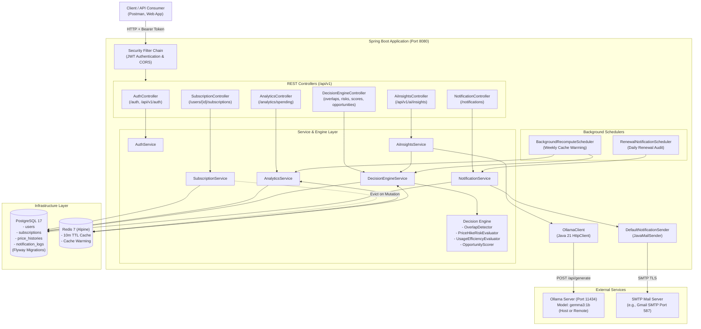
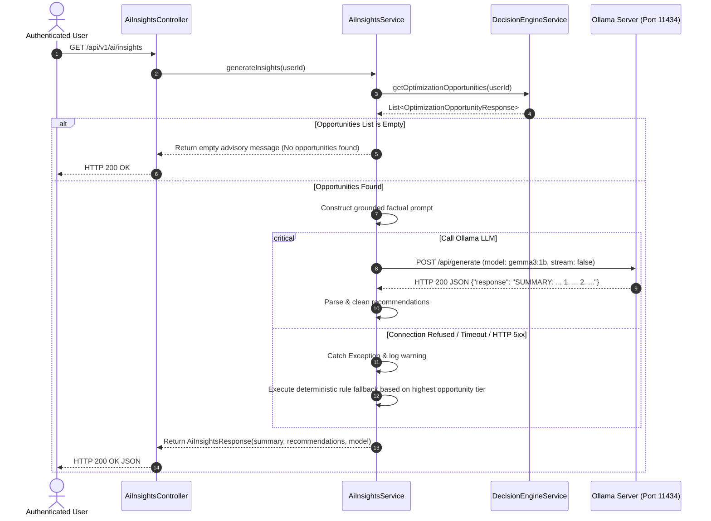

# SubSense — Subscription Intelligence Platform

> An intelligent, data-driven backend platform built with **Spring Boot 3**, **PostgreSQL**, **Redis**, and **Ollama (Local LLM)**. SubSense enables users to audit digital subscriptions, track recurring spending, detect overlapping services, evaluate renewal price hike risks, compute usage efficiency scores, receive automated renewal email alerts, and obtain grounded AI advisory insights with automated fallback.

---

## Table of Contents

- [Overview & Problem Statement](#overview--problem-statement)
- [Key Features](#key-features)
- [Architecture Overview](#architecture-overview)
- [Request Flow & AI Fallback Resilience](#request-flow--ai-fallback-resilience)
- [Technology Stack](#technology-stack)
- [System Requirements & Prerequisites](#system-requirements--prerequisites)
- [Project Structure](#project-structure)
- [Local Development Setup](#local-development-setup)
- [Environment Variable Configuration](#environment-variable-configuration)
- [Database & Redis Setup](#database--redis-setup)
- [Ollama AI Integration](#ollama-ai-integration)
- [SMTP Email Notifications & Reliability](#smtp-email-notifications--reliability)
- [Docker & Docker Compose Deployment](#docker--docker-compose-deployment)
- [API Documentation & Endpoint Reference](#api-documentation--endpoint-reference)
  - [Authentication](#1-authentication)
  - [Subscription Management](#2-subscription-management)
  - [Decision Engine & Analytics](#3-decision-engine--analytics)
  - [AI-Generated Insights](#4-ai-generated-insights)
  - [Renewal Notifications](#5-renewal-notifications)
- [Authentication & Security Implementation](#authentication--security-implementation)
- [Testing Guide](#testing-guide)
- [Troubleshooting](#troubleshooting)
- [Future Enhancements](#future-enhancements)
- [Contributing](#contributing)
- [License & Author](#license--author)

---

## Overview & Problem Statement

### The Problem
Modern consumers and organizations subscribe to dozens of recurring services across entertainment, software, cloud infrastructure, and fitness. Over time, recurring costs compound unnoticed due to:
* **Silent Price Creep**: Vendors regularly increase subscription prices over time without prominent consumer warnings.
* **Underutilization & Ghost Subscriptions**: Services remain active and billed for months despite zero user interaction.
* **Redundant Overlaps**: Multiple subscriptions serving identical purposes (e.g., Netflix, Disney+, and HBO in Entertainment; or AWS and DigitalOcean in Software) run simultaneously.
* **Missed Renewal Deadlines**: Annual or quarterly renewals process automatically before users have an opportunity to review usage or cancel.

### The Solution
**SubSense** transforms basic subscription tracking into an **actionable intelligence platform**. In addition to standard subscription lifecycle CRUD, SubSense provides:
1. **Deterministic Analytics**: Immediate detection of category overlaps, historical price hike calculations, and usage recency scoring.
2. **Prioritized Optimization Opportunities**: A composite scoring engine that identifies the highest-impact subscriptions to cancel, downgrade, or review.
3. **Local LLM Advisory (Ollama)**: Grounded AI insights generated using `gemma3:1b` running locally—preserving data privacy and avoiding external API costs, with automatic fallback to deterministic rules if the AI daemon is unreachable.
4. **Automated Renewal Protection**: Scheduled daily scans and SMTP reminder emails dispatched within a configurable renewal window.

---

## Key Features

### 1. User Authentication & Authorization
* **Stateless JWT Security**: Token-based authentication using `io.jsonwebtoken` (JJWT 0.12.5) with HMAC-SHA256 signing.
* **Password Hashing**: Strong credential encryption using Spring Security's `BCryptPasswordEncoder`.
* **Resource Ownership Enforcement**: Dynamic security checks prevent horizontal privilege escalation (Insecure Direct Object References - IDOR) by verifying that authenticated callers own the requested user ID or possess `ROLE_ADMIN`.

### 2. Subscription Lifecycle Management
* **Full CRUD Operations**: Create, view, update, and delete digital subscriptions with strict payload validation.
* **Categorization & Billing Cycles**: Supports `ENTERTAINMENT`, `SOFTWARE`, `UTILITIES`, `FITNESS`, `WORK`, `EDUCATION`, and `OTHER` across `WEEKLY`, `MONTHLY`, `QUARTERLY`, and `YEARLY` intervals.
* **Optimistic Concurrency Control**: Entity-level `@Version` locking on `Subscription` entities to detect and reject concurrent conflicting updates with HTTP `409 Conflict`.
* **Activity Tracking**: Dedicated `PATCH .../mark-used` endpoint to track service interaction timestamps (`lastUsedAt`).

### 3. Decision Engine & Intelligence
SubSense executes four specialized decision algorithms:
* **Category Overlap Detection (`OverlapDetector`)**: Identifies categories with multiple active subscriptions. Normalizes all billing cycles to a monthly baseline, calculates total category spend, and projects monthly savings if redundant services are consolidated.
* **Price Hike Risk Evaluation (`PriceHikeRiskEvaluator`)**: Audits historical price changes from the `price_histories` table. Assigns risk tiers (`LOW`, `MEDIUM`, `HIGH`, `UNKNOWN`) based on the frequency and magnitude of past price jumps.
* **Usage Efficiency Scoring (`UsageEfficiencyEvaluator`)**: Measures elapsed days since `lastUsedAt`. Classifies subscriptions into `OPTIMAL` ($\le 30$ days), `UNDERUTILIZED` ($> 30$ days), `INEFFICIENT` ($> 60$ days), or `NEVER_USED`.
* **Composite Optimization Opportunities (`DecisionEngine`)**: Synthesizes overlaps (+35 pts), usage inactivity (up to +40 pts), and price hike risks (up to +25 pts) into a unified 0–100 score. Categorizes actionable savings into `HIGH` ($\ge 60$), `MEDIUM` ($\ge 35$), and `LOW` tiers with estimated annual financial impact.

### 4. Grounded AI Insights (Ollama)
* **Local LLM Inference**: Communicates over HTTP with an Ollama daemon running the open-weight `gemma3:1b` model.
* **Prompt Grounding**: Strict system prompts instruct the model to use only verified subscription facts from the decision engine.
* **Resilient Graceful Fallback**: If Ollama is offline, unreachable, or times out, `AiInsightsService` logs a warning and returns deterministic, data-grounded summaries and recommendations without failing the user request.

### 5. Automated Renewal Reminders & Email Notifications
* **Daily Scheduled Audits**: A background cron job scans for upcoming subscription renewals within a configurable window (default: 7 days).
* **SMTP Dispatcher**: Dispatches notification emails via Spring's `JavaMailSender` (tested with Gmail SMTP and custom relays).
* **Reliable Retry Mechanism**: Tracks delivery attempts in `notification_logs`. Failed dispatches are retried up to 3 times after a fixed 15-minute backoff threshold.
* **Idempotency**: Enforced by a composite database unique constraint `(subscription_id, renewal_date, notification_type)` preventing duplicate emails.

### 6. Caching & Performance Optimization
* **Redis Caching**: Caches computationally intensive analytics (`overlaps`, `renewal_risks`, `efficiency_scores`, `optimization_opportunities`, `spending_analytics`) with a default 10-minute TTL.
* **Automated Cache Warming**: A weekly background job recomputes and repopulates Redis caches for all registered users via an asynchronous thread pool.
* **Cache Error Handling**: Non-blocking `CacheErrorHandler` ensures database and API requests continue unimpeded if Redis experiences a temporary disruption.

---

## Architecture Overview



---

## Request Flow & AI Fallback Resilience

The AI advisory feature (`GET /api/v1/ai/insights`) incorporates a deterministic fallback pattern:



---

## Technology Stack

| Technology | Verified Version | Purpose |
|---|---|---|
| **Java** | `21` | Core programming language (JDK 21 LTS with text blocks, pattern matching, `HttpClient`) |
| **Spring Boot** | `3.3.4` | Application framework (`web`, `data-jpa`, `security`, `data-redis`, `mail`, `validation`) |
| **Spring Security** | `6.3.x` | Stateless security architecture, BCrypt password encryption, authorization filters |
| **JJWT** | `0.12.5` | JSON Web Token (JWT) creation, signing, and signature verification |
| **PostgreSQL** | `17` (Compose) / `15+` (Local) | Primary relational database for transactional entity persistence |
| **Flyway** | `10.x` | Database schema migrations (`classpath:db/migration/V1__initial_schema.sql`) |
| **Redis** | `7-alpine` | In-memory distributed caching layer for high-throughput decision analytics |
| **Ollama** | External Daemon | Local open-weight LLM execution runtime running `gemma3:1b` |
| **Spring Mail** | `3.3.4` | SMTP client abstraction for subscription renewal notification emails |
| **Hibernate / JPA** | `6.5.x` | Object-relational mapping, pagination, and optimistic locking (`@Version`) |
| **MapStruct** | `1.5.5.Final` | Compile-time type-safe DTO and entity mapping |
| **Lombok** | `1.18.34` | Compile-time boilerplate reduction (`@Getter`, `@Builder`, etc.) |
| **Docker Compose** | Compose v2 | Local container orchestration for PostgreSQL, Redis, and backend service |

---

## System Requirements & Prerequisites

Ensure the following tools are installed before running locally:

* **Java Development Kit (JDK)**: Version `21` or higher. Verify with `java -version`.
* **Maven**: Version `3.8+` (or use the included `./mvnw` wrapper).
* **PostgreSQL**: Version `15+` running on port `5432` (if running outside Docker).
* **Redis**: Version `6+` running on port `6379` (if running outside Docker).
* **Ollama**: Installed locally on the host machine (recommended for macOS Metal GPU acceleration) or available remotely.
* **Docker & Docker Compose**: (Optional, for containerized execution).

---

## Project Structure

```text
subscription-intelligence-platform/
├── .mvn/wrapper/                  # Maven wrapper binaries and configuration
├── src/
│   ├── main/
│   │   ├── java/com/aathithiyan/subscription/
│   │   │   ├── ai/                # Ollama HTTP client implementation
│   │   │   ├── config/            # Cache, Security, Async, and DataSeeder configurations
│   │   │   ├── controller/        # REST API controllers (/auth, /subscriptions, /analytics, /ai, /notifications)
│   │   │   ├── domain/            # Domain enums (BillingCycle, Role, SubscriptionCategory, etc.)
│   │   │   ├── dto/               # Request and response transfer objects
│   │   │   ├── engine/            # Overlap, PriceHikeRisk, and UsageEfficiency business logic
│   │   │   ├── entity/            # JPA entities (User, Subscription, PriceHistory, NotificationLog)
│   │   │   ├── exception/         # Centralized error handling (@RestControllerAdvice)
│   │   │   ├── mapper/            # MapStruct mappers
│   │   │   ├── repository/        # Spring Data JPA repositories and custom SQL projections
│   │   │   ├── scheduler/         # Background cron jobs (Renewal notifications, Cache warming)
│   │   │   ├── security/          # JWT authentication filter, token provider, user details
│   │   │   └── service/           # Application service orchestration layer
│   │   └── resources/
│   │       ├── db/migration/      # Flyway SQL migrations (V1__initial_schema.sql)
│   │       └── application.properties # Main application properties
│   └── test/                      # Comprehensive unit and slice integration tests
├── .dockerignore                  # Docker build context exclusions
├── .env.example                   # Reference environment configuration template
├── compose.yaml                   # Docker Compose configuration (Postgres, Redis, Backend)
├── Dockerfile                     # Multi-stage production container build definition
├── mvnw / mvnw.cmd                # Maven wrapper execution scripts
└── pom.xml                        # Maven dependencies and build plugins
```

---

## Local Development Setup

### 1. Clone the Repository
```bash
git clone https://github.com/aathithiyan45/subscription-intelligence-platform.git
cd subscription-intelligence-platform
```

### 2. Configure Environment Variables
Copy the template file to create your active `.env`:
```bash
cp .env.example .env
```
Open `.env` and fill in your database credentials and a secure 256-bit base64-encoded secret for `JWT_SECRET`.

### 3. Initialize PostgreSQL & Redis

**PostgreSQL**:
Create the database in your local PostgreSQL instance:
```bash
# macOS (Homebrew) or Linux
createdb subscription_intelligence
```

**Redis**:
Start the Redis server:
```bash
# macOS (Homebrew)
brew services start redis

# Verify Redis is responsive
redis-cli ping
# Output: PONG
```

### 4. Build and Run the Application
Use the Maven wrapper to start the Spring Boot application:
```bash
./mvnw spring-boot:run
```

The application will launch on `http://localhost:8080`. Flyway will automatically execute migrations in `src/main/resources/db/migration/` on startup.

---

## Environment Variable Configuration

SubSense utilizes Spring Property interpolation to externalize all sensitive and environment-specific settings.

| Variable Name | Required | Default Value | Purpose / Description |
|---|---|---|---|
| `DB_URL` | **Yes** | `jdbc:postgresql://localhost:5432/subscription_intelligence` | PostgreSQL JDBC connection URL |
| `DB_USERNAME` | **Yes** | `your_postgres_username` | PostgreSQL database username |
| `DB_PASSWORD` | **Yes** | `your_postgres_password` | PostgreSQL database password |
| `JWT_SECRET` | **Yes** | `your_jwt_secret` | Base64-encoded HMAC-SHA256 secret key for signing tokens |
| `JWT_EXPIRATION_MS` | No | `86400000` | JWT token validity window in milliseconds (default: 24 hours) |
| `REDIS_HOST` | No | `localhost` | Redis host address (`redis` inside Docker Compose) |
| `REDIS_PORT` | No | `6379` | Redis port number |
| `CACHE_WARMING_CRON` | No | `0 0 2 * * SUN` | Cron expression for weekly analytics cache warming (Sundays 2:00 AM) |
| `NOTIFICATION_RENEWAL_CRON` | No | `0 0 8 * * *` | Cron expression for renewal reminder audits (Daily 8:00 AM) |
| `NOTIFICATION_RENEWAL_WINDOW_DAYS` | No | `7` | How many days ahead to scan for upcoming renewals |
| `OLLAMA_BASE_URL` | No | `http://localhost:11434` | Ollama HTTP endpoint (`http://host.docker.internal:11434` in Docker) |
| `OLLAMA_MODEL` | No | `gemma3:1b` | Target LLM model pulled in Ollama |
| `OLLAMA_TIMEOUT_SECONDS` | No | `30` | Connect and read timeout in seconds for Ollama requests |
| `MAIL_HOST` | No | `smtp.gmail.com` | SMTP server host |
| `MAIL_PORT` | No | `587` | SMTP server port (587 for TLS) |
| `MAIL_USERNAME` | No | _(empty)_ | SMTP authentication username / sender email |
| `MAIL_PASSWORD` | No | _(empty)_ | SMTP authentication password / App Password |
| `MAIL_FROM` | No | `noreply@subsense.com` | `From` email address header |
| `DATA_SEED_ENABLED` | No | `true` | Enables sample data seeding on startup (disabled in `prod` profile) |

---

## Database & Redis Setup

### Flyway Migrations
Database schema versioning is handled automatically on application startup via Flyway. The migration script [V1__initial_schema.sql](file:///Users/athiselvam/SpringBoot/Project/subscription-intelligence-platform/src/main/resources/db/migration/V1__initial_schema.sql) provisions:
* `users`: User identity, hashed passwords, and roles.
* `subscriptions`: Subscription records with billing cycles, categories, active statuses, and optimistic lock versioning.
* `price_histories`: Historical price logs associated with subscriptions to measure price hikes.
* `notification_logs`: Audit trail for renewal emails, statuses (`PENDING`, `SENT`, `FAILED`), and retry counts.

### Default Sample Data (DataSeeder)
When starting in non-production profiles with `DATA_SEED_ENABLED=true`, [DataSeeder.java](file:///Users/athiselvam/SpringBoot/Project/subscription-intelligence-platform/src/main/java/com/aathithiyan/subscription/config/DataSeeder.java) automatically initializes a test account:
* **Email**: `test@example.com`
* **Password**: `password123`
* **Pre-seeded Subscriptions**: Netflix Premium, Disney+ Bundle, Equinox Gym, AWS Cloud Services, Spotify Family, and ChatGPT Plus (configured to trigger overlap, inactivity, and price hike analytics).

---

## Ollama AI Integration

SubSense uses [Ollama](https://ollama.com/) to execute compact, open-weight language models locally.

### Why Ollama?
* **Zero API Costs**: No recurring per-token fees to proprietary API providers.
* **Strict Data Privacy**: Financial subscription data, monthly spending, and usage metrics never leave your local environment.
* **Predictable Latency**: Local execution without third-party rate limits.

### 1. Install and Start Ollama
Install Ollama from [ollama.com](https://ollama.com) or via Homebrew on macOS:
```bash
brew install ollama
```
Start the Ollama daemon:
```bash
ollama serve
```

### 2. Download the Configured Model
Pull the default `gemma3:1b` model:
```bash
ollama pull gemma3:1b
```
Confirm the model is downloaded:
```bash
ollama list
```

### 3. Container Networking Distinction (Crucial)
Container isolation changes how the Spring Boot application must reach Ollama:
* **Local Run (`./mvnw spring-boot:run`)**: Set `OLLAMA_BASE_URL=http://localhost:11434`.
* **Docker Compose Stack**: Inside a container, `localhost` refers to the container itself. In `compose.yaml`, the backend is configured with:
  ```yaml
  extra_hosts:
    - "host.docker.internal:host-gateway"
  environment:
    OLLAMA_BASE_URL: ${OLLAMA_BASE_URL:-http://host.docker.internal:11434}
  ```
  This routes requests out of the Docker bridge network to the Ollama process on your host.

### 4. Observing AI Fallback
If Ollama is stopped or unavailable, the endpoint `GET /api/v1/ai/insights` gracefully returns deterministic recommendations. To observe this in the logs:
```bash
# Check for fallback log warnings
docker compose logs backend | grep -i "Ollama AI insights generation failed"
```

---

## SMTP Email Notifications & Reliability

### Overview
SubSense dispatches renewal reminder emails to notify users before their credit cards are charged for recurring subscriptions.

### Gmail SMTP Configuration
To use Gmail SMTP:
1. Ensure **2-Step Verification** is enabled on your Google Account.
2. Generate an **App Password**: Go to **Google Account $\rightarrow$ Security $\rightarrow$ 2-Step Verification $\rightarrow$ App Passwords**.
3. Set the generated 16-character password in your `.env` file:
   ```properties
   MAIL_HOST=smtp.gmail.com
   MAIL_PORT=587
   MAIL_USERNAME=your_email@gmail.com
   MAIL_PASSWORD=your_16_character_app_password
   MAIL_FROM=your_email@gmail.com
   ```

### Reliability & Retry Strategy
* **Audit Execution**: The `RenewalNotificationScheduler` runs daily at 8:00 AM (configurable via `NOTIFICATION_RENEWAL_CRON`).
* **Fixed Retry Backoff**: When a dispatch fails (e.g., SMTP network timeout), the record status is set to `FAILED` with the error message recorded. The service queries for retriable jobs whose `lastAttemptAt` was at least **15 minutes ago** (`findPendingAndRetriableNotifications(backoffThreshold)`).
* **Maximum Retries**: Dispatches are attempted up to `3` times before transitioning permanently to failed status.
* **Idempotency Protection**: A database constraint prevents multiple reminder records for the same subscription on the same renewal date.

---

## Docker & Docker Compose Deployment

The repository includes a coordinated multi-container setup in [compose.yaml](file:///Users/athiselvam/SpringBoot/Project/subscription-intelligence-platform/compose.yaml) running:
1. `subscription-postgres`: PostgreSQL 17 database with persistent data volume `postgres_data`.
2. `subscription-redis`: Redis 7 in-memory cache with container health checks.
3. `subscription-backend`: Spring Boot 3 application built from the local multi-stage [Dockerfile](file:///Users/athiselvam/SpringBoot/Project/subscription-intelligence-platform/Dockerfile).

### Multi-Stage Dockerfile Lifecycle
* **Stage 1 (Build)**: `eclipse-temurin:21-jdk` downloads dependencies offline and compiles an optimized executable JAR.
* **Stage 2 (Runtime)**: `eclipse-temurin:21-jre` runs the application as a minimal, non-root capable runtime image.

### Docker Compose Commands

#### 1. Validate Compose File Syntax
```bash
docker compose config
```

#### 2. Build and Start the Entire Stack
```bash
docker compose up --build -d
```

#### 3. Monitor Service Health & Status
```bash
docker compose ps
```
Both `subscription-postgres` and `subscription-redis` report `(healthy)` via built-in health checks (`pg_isready` and `redis-cli ping`).

#### 4. Stream Backend Logs
```bash
docker compose logs -f backend
```

#### 5. Verify PostgreSQL & Redis from Inside Containers
```bash
# Verify Postgres is ready
docker compose exec postgres pg_isready -U athiselvam -d subscription_intelligence

# Verify Redis is answering pings
docker compose exec redis redis-cli ping
```

#### 6. Stop the Services
```bash
# Stop containers (preserves volume data)
docker compose down

# Stop containers and remove volumes
docker compose down -v
```

---

## API Documentation & Endpoint Reference

Base URL: `http://localhost:8080`

Protected endpoints require the standard header:
```text
Authorization: Bearer <JWT_TOKEN>
```

---

### 1. Authentication

#### Register New User
* **Method**: `POST`
* **Route**: `/api/v1/auth/register` (also `/auth/register`)
* **Auth**: Public
* **Request Body**:
  ```json
  {
    "email": "user@example.com",
    "password": "Password@123"
  }
  ```
* **Response (`201 Created`)**:
  ```json
  {
    "token": "eyJhbGciOiJIUzI1NiIsInR5cCI6IkpXVCJ9...",
    "tokenType": "Bearer",
    "userId": 1,
    "email": "user@example.com",
    "role": "USER"
  }
  ```

#### Login User
* **Method**: `POST`
* **Route**: `/api/v1/auth/login` (also `/auth/login`)
* **Auth**: Public
* **Request Body**:
  ```json
  {
    "email": "test@example.com",
    "password": "password123"
  }
  ```
* **Response (`200 OK`)**:
  ```json
  {
    "token": "eyJhbGciOiJIUzI1NiIsInR5cCI6IkpXVCJ9...",
    "tokenType": "Bearer",
    "userId": 1,
    "email": "test@example.com",
    "role": "USER"
  }
  ```

---

### 2. Subscription Management

#### Create Subscription
* **Method**: `POST`
* **Route**: `/api/v1/users/{userId}/subscriptions`
* **Auth**: Required (`ROLE_USER` or `ROLE_ADMIN`)
* **Request Body**:
  ```json
  {
    "name": "GitHub Copilot",
    "price": 10.00,
    "billingCycle": "MONTHLY",
    "category": "SOFTWARE",
    "status": "ACTIVE",
    "lastUsedAt": "2026-10-20T10:00:00"
  }
  ```
* **Response (`201 Created`)**:
  ```json
  {
    "id": 7,
    "userId": 1,
    "name": "GitHub Copilot",
    "price": 10.00,
    "billingCycle": "MONTHLY",
    "category": "SOFTWARE",
    "status": "ACTIVE",
    "lastUsedAt": "2026-10-20T10:00:00",
    "version": 0,
    "createdAt": "2026-10-24T12:00:00",
    "updatedAt": "2026-10-24T12:00:00"
  }
  ```

#### List Subscriptions (Paginated & Filtered)
* **Method**: `GET`
* **Route**: `/api/v1/users/{userId}/subscriptions?page=0&size=10&status=ACTIVE&category=ENTERTAINMENT`
* **Auth**: Required
* **Response (`200 OK`)**:
  ```json
  {
    "content": [
      {
        "id": 1,
        "userId": 1,
        "name": "Netflix Premium",
        "price": 22.99,
        "billingCycle": "MONTHLY",
        "category": "ENTERTAINMENT",
        "status": "ACTIVE",
        "lastUsedAt": "2026-10-23T18:00:00",
        "version": 3,
        "createdAt": "2026-04-20T10:00:00",
        "updatedAt": "2026-10-14T10:00:00"
      }
    ],
    "page": 0,
    "size": 10,
    "totalElements": 1,
    "totalPages": 1,
    "last": true
  }
  ```

#### Get Subscription by ID
* **Method**: `GET`
* **Route**: `/api/v1/users/{userId}/subscriptions/{subscriptionId}`
* **Auth**: Required
* **Response (`200 OK`)**: Returns single `SubscriptionResponse` object.

#### Update Subscription
* **Method**: `PUT`
* **Route**: `/api/v1/users/{userId}/subscriptions/{subscriptionId}`
* **Auth**: Required
* **Request Body**:
  ```json
  {
    "name": "Netflix 4K Ultra",
    "price": 24.99,
    "billingCycle": "MONTHLY",
    "category": "ENTERTAINMENT",
    "status": "ACTIVE",
    "lastUsedAt": "2026-10-24T09:00:00"
  }
  ```
* **Response (`200 OK`)**: Returns updated `SubscriptionResponse` (automatically appends an entry to `price_histories` if `price` changed).

#### Delete Subscription
* **Method**: `DELETE`
* **Route**: `/api/v1/users/{userId}/subscriptions/{subscriptionId}`
* **Auth**: Required
* **Response (`204 No Content`)**

#### Mark Subscription Used
* **Method**: `PATCH`
* **Route**: `/api/v1/subscriptions/{subscriptionId}/mark-used` (or `/api/v1/users/{userId}/subscriptions/{subscriptionId}/mark-used`)
* **Auth**: Required
* **Purpose**: Updates `lastUsedAt` to the current server timestamp.
* **Response (`200 OK`)**: Returns updated `SubscriptionResponse`.

---

### 3. Decision Engine & Analytics

#### Get Spending Analytics
* **Method**: `GET`
* **Route**: `/api/v1/analytics/spending?period=monthly` (or `/api/v1/users/{userId}/analytics/spending`)
* **Auth**: Required
* **Response (`200 OK`)**:
  ```json
  {
    "period": "monthly",
    "totalMonthlySpend": 313.96,
    "totalActiveSubscriptions": 6,
    "byCategory": [
      {
        "category": "SOFTWARE",
        "totalSpend": 149.99,
        "percentage": 47.77
      },
      {
        "category": "FITNESS",
        "totalSpend": 89.00,
        "percentage": 28.35
      },
      {
        "category": "ENTERTAINMENT",
        "totalSpend": 54.97,
        "percentage": 17.51
      },
      {
        "category": "WORK",
        "totalSpend": 20.00,
        "percentage": 6.37
      }
    ],
    "historicalTrend": [
      {
        "period": "2026-04",
        "totalAmount": 15.99
      },
      {
        "period": "2026-07",
        "totalAmount": 19.99
      },
      {
        "period": "2026-10",
        "totalAmount": 22.99
      }
    ]
  }
  ```

#### Detect Category Overlaps
* **Method**: `GET`
* **Route**: `/api/v1/analytics/overlaps` (or `/api/v1/users/{userId}/analytics/overlaps`)
* **Auth**: Required
* **Response (`200 OK`)**:
  ```json
  [
    {
      "category": "ENTERTAINMENT",
      "activeSubscriptionsCount": 3,
      "totalMonthlySpendInCategory": 54.97,
      "potentialMonthlySavings": 39.98,
      "subscriptions": [
        { "id": 1, "name": "Netflix Premium", "price": 22.99 },
        { "id": 2, "name": "Disney+ Bundle", "price": 14.99 },
        { "id": 5, "name": "Spotify Family", "price": 16.99 }
      ]
    }
  ]
  ```

#### Evaluate Renewal Price Hike Risks
* **Method**: `GET`
* **Route**: `/api/v1/analytics/renewal-risk` (or `/api/v1/users/{userId}/analytics/renewal-risk`)
* **Auth**: Required
* **Response (`200 OK`)**:
  ```json
  [
    {
      "subscriptionId": 1,
      "subscriptionName": "Netflix Premium",
      "currentPrice": 22.99,
      "previousPrice": 19.99,
      "riskTier": "HIGH",
      "priceIncreaseCount": 2,
      "totalIncreasePercentage": 43.78,
      "recommendation": "High renewal risk: Significant cumulative price increases detected over time."
    }
  ]
  ```

#### Get Usage Efficiency Scores
* **Method**: `GET`
* **Route**: `/api/v1/analytics/efficiency-scores` (or `/api/v1/users/{userId}/analytics/efficiency-scores`)
* **Auth**: Required
* **Response (`200 OK`)**:
  ```json
  [
    {
      "subscriptionId": 3,
      "subscriptionName": "Equinox Gym",
      "daysSinceLastUsed": 45,
      "efficiencyScore": 40.0,
      "efficiencyTier": "UNDERUTILIZED",
      "monthlyPrice": 89.00,
      "recommendation": "Underutilized: Subscription has not been used in over 30 days."
    }
  ]
  ```

#### Get Prioritized Optimization Opportunities
* **Method**: `GET`
* **Route**: `/api/v1/analytics/optimization-opportunities` (or `/api/v1/users/{userId}/analytics/optimization-opportunities`)
* **Auth**: Required
* **Response (`200 OK`)**:
  ```json
  [
    {
      "subscriptionId": 1,
      "subscriptionName": "Netflix Premium",
      "category": "ENTERTAINMENT",
      "monthlyPrice": 22.99,
      "estimatedAnnualSavings": 275.88,
      "opportunityTier": "HIGH",
      "score": 60.0,
      "reasons": [
        "Category 'ENTERTAINMENT' has multiple redundant active subscriptions.",
        "Price hike risk is HIGH (escalated >20% or multiple price increases)."
      ],
      "suggestedAction": "Cancel or downgrade subscription to save $275.88/year."
    }
  ]
  ```

---

### 4. AI-Generated Insights

#### Get AI Advisory Insights
* **Method**: `GET`
* **Route**: `/api/v1/ai/insights`
* **Auth**: Required
* **Response (`200 OK`)**:
  ```json
  {
    "summary": "You have redundant streaming services in ENTERTAINMENT accompanied by steep cumulative price increases on Netflix Premium.",
    "keyRecommendations": [
      "Review whether family members actively stream on both Netflix and Disney+ before your next renewal billing cycle.",
      "Consider consolidating your entertainment subscriptions to save approximately $275.88 annually."
    ],
    "model": "gemma3:1b"
  }
  ```

---

### 5. Renewal Notifications

#### List User Notifications
* **Method**: `GET`
* **Route**: `/api/v1/notifications` (or `/api/v1/users/{userId}/notifications`)
* **Auth**: Required
* **Response (`200 OK`)**:
  ```json
  [
    {
      "id": 1,
      "subscriptionId": 1,
      "subscriptionName": "Netflix Premium",
      "renewalDate": "2026-11-01",
      "notificationType": "RENEWAL_REMINDER",
      "status": "SENT",
      "retryCount": 0,
      "sentAt": "2026-10-24T08:00:15",
      "errorMessage": null
    }
  ]
  ```

---

## Authentication & Security Implementation

### JWT Security Flow
1. **Client Login**: Client transmits credentials to `/api/v1/auth/login`.
2. **Token Issuance**: `JwtTokenProvider` validates the credentials and constructs a signed JWT containing `userId`, `email`, and `roles`.
3. **Filter Interception**: `JwtAuthenticationFilter` intercepts incoming requests, validates the signature against `app.jwt.secret`, and populates Spring's `SecurityContext`.
4. **Endpoint Access**: The request proceeds to the controller with `UserPrincipal` injected via `@AuthenticationPrincipal`.

### Horizontal Privilege Protection
To prevent IDOR vulnerabilities, controllers invoke `validateUserOwnership(Long pathUserId)`:
```java
private void validateUserOwnership(Long pathUserId) {
    Authentication auth = SecurityContextHolder.getContext().getAuthentication();
    if (auth != null && auth.getPrincipal() instanceof UserPrincipal principal) {
        boolean isAdmin = principal.getAuthorities().stream()
                .anyMatch(a -> a.getAuthority().equals("ROLE_ADMIN"));
        if (!isAdmin && !principal.getId().equals(pathUserId)) {
            throw new ResourceNotFoundException("User", "id", pathUserId);
        }
    }
}
```
*Note*: The application intentionally returns a generic `404 Not Found` rather than `403 Forbidden` to prevent malicious actors from enumerating existing user IDs.

---

## Testing Guide

### 1. Pure Unit Tests (Isolated & Fast)
These tests execute without external databases, network sockets, or container dependencies:
```bash
# Run Decision Engine, Overlap, Risk, Efficiency, and Notification Sender unit tests
./mvnw test -Dtest="*EngineTest,*EvaluatorTest,*DetectorTest,*SenderTest"

# Run Ollama Client & AI Insights fallback unit tests
./mvnw test -Dtest=AiInsightsServiceTest,OllamaClientTest
```
*Verified Status*: **100% Passing (26/26 tests executed and green)**.

### 2. Controller Slice Tests (WebMvcTest)
Test controller routing, JSON serialization, and Spring Security rules with mocked service beans:
```bash
./mvnw test -Dtest=AiInsightsControllerTest
```
*Verified Status*: **100% Passing (2/2 tests green)**.

### 3. Full Integration Tests (@SpringBootTest)
Integration tests loading the full application context require database connectivity. To execute with the in-memory H2 test configuration:
```bash
./mvnw test -Dtest=RepositoryLayerTest -Dspring.profiles.active=test
```

---

## Troubleshooting

### 1. Connection Refused to Ollama inside Docker
* **Symptom**: Logs display `Ollama AI insights generation failed: Could not communicate with Ollama`.
* **Root Cause**: Container networking loopback issue. The container is attempting to reach `http://localhost:11434`.
* **Remedy**: Ensure `compose.yaml` specifies `OLLAMA_BASE_URL: http://host.docker.internal:11434` and `extra_hosts: - "host.docker.internal:host-gateway"`. If running Ollama on macOS, verify Ollama is running (`open -a Ollama` or `ollama serve`).

### 2. Model Not Found (`gemma3:1b`)
* **Symptom**: Ollama returns HTTP 404 or fails immediately.
* **Remedy**: Download the model explicitly on the host machine:
  ```bash
  ollama pull gemma3:1b
  ```

### 3. PostgreSQL or Redis Port Conflicts
* **Symptom**: `Bind for 0.0.0.0:5432 failed: port is already allocated`.
* **Remedy**: Another PostgreSQL or Redis instance is running locally on the host. Stop local services (`brew services stop postgresql@17` or `systemctl stop postgresql`) before running `docker compose up`.

### 4. Flyway Migration Failures
* **Symptom**: `FlywayException: Validate failed: Migrations have failed validation`.
* **Remedy**: If schema migrations were altered after initial execution, repair the Flyway schema history table or drop and recreate the development database:
  ```bash
  dropdb subscription_intelligence && createdb subscription_intelligence
  ```

---

## Future Enhancements

The following capabilities are candidate milestones for future platform releases:

* **Modern Web Dashboard**: A single-page frontend application (e.g., React or Vue with Vite) integrated with the backend's pre-configured CORS endpoint (`http://localhost:5173`).
* **Financial Data Ingestion**: Automated transaction syncing via bank integration aggregators (Plaid, Yapily, or Stripe webhooks).
* **Multi-Currency Normalization**: Dynamic currency conversion rates (USD, EUR, GBP, INR) to unify global subscriptions under a single currency view.
* **Multi-Channel Push Notifications**: SMS alerts and browser push notifications (via Twilio or Firebase Cloud Messaging) alongside existing SMTP email delivery.
* **Machine Learning Budget Forecasting**: Predictive monthly spending projections based on seasonal churn and recurring renewal cycles.

---

## Contributing

Contributions are welcome. Follow these steps to submit improvements:

1. **Fork the Repository**: Create your personal fork on GitHub.
2. **Create a Feature Branch**:
   ```bash
   git checkout -b feat/your-feature-name
   ```
3. **Commit Following Conventional Commits**:
   ```bash
   git commit -m "feat(analytics): add export to CSV functionality"
   ```
4. **Ensure Tests Pass**:
   ```bash
   ./mvnw clean test-compile
   ./mvnw test -Dtest="*EngineTest,*EvaluatorTest,*DetectorTest,*SenderTest,AiInsightsServiceTest,OllamaClientTest"
   ```
5. **Open a Pull Request**: Submit your pull request to the `main` branch with a clear summary of modifications.

---

## License & Author

### License
*Note: This repository does not currently include a formal open-source license file (`LICENSE`). Please contact the author for licensing terms and reuse permissions.*

### Author
**Aathithiyan P**  
* B.Tech Information Technology, Saranathan College of Engineering, Trichy  
* GitHub: [@aathithiyan45](https://github.com/aathithiyan45)
